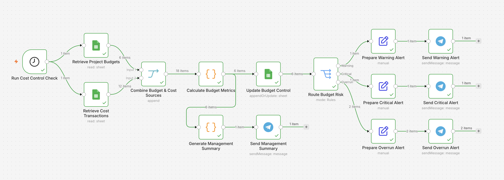
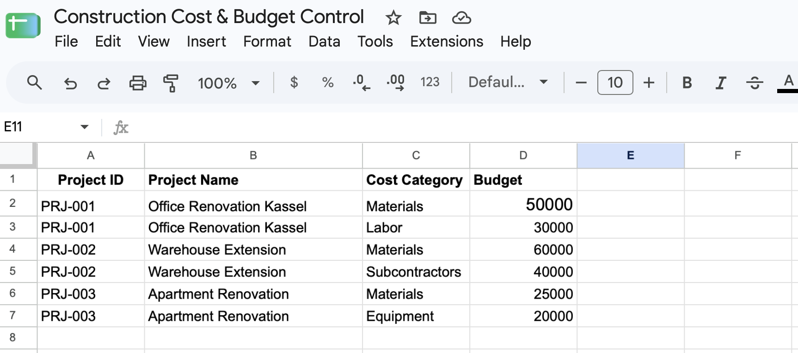
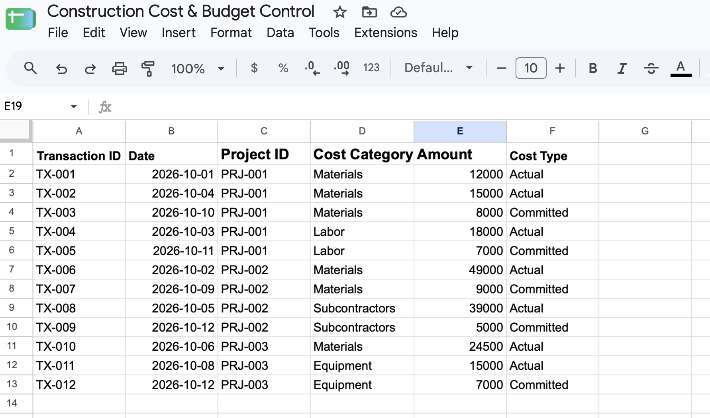
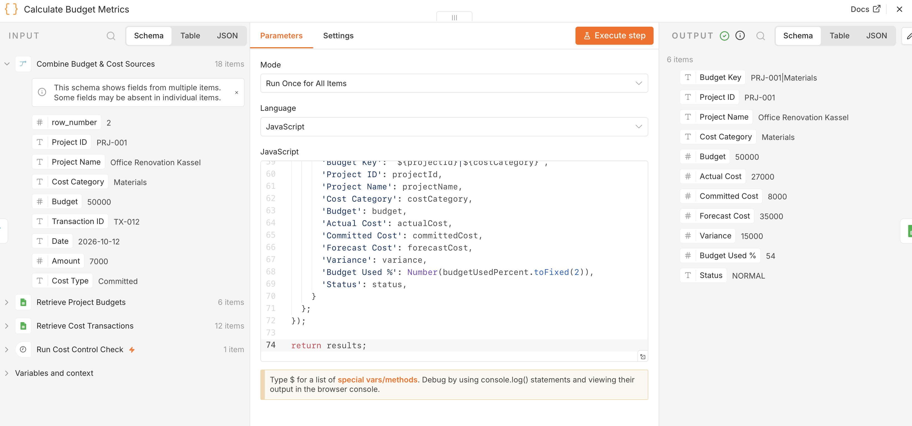
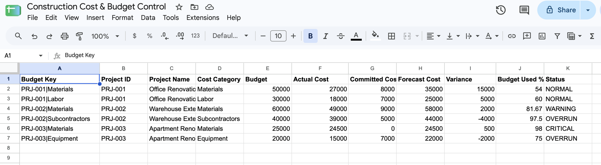
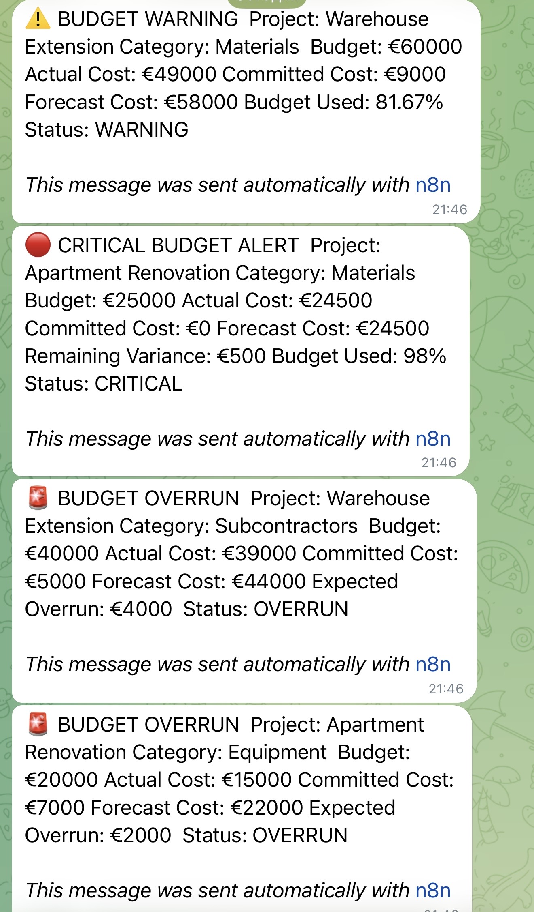
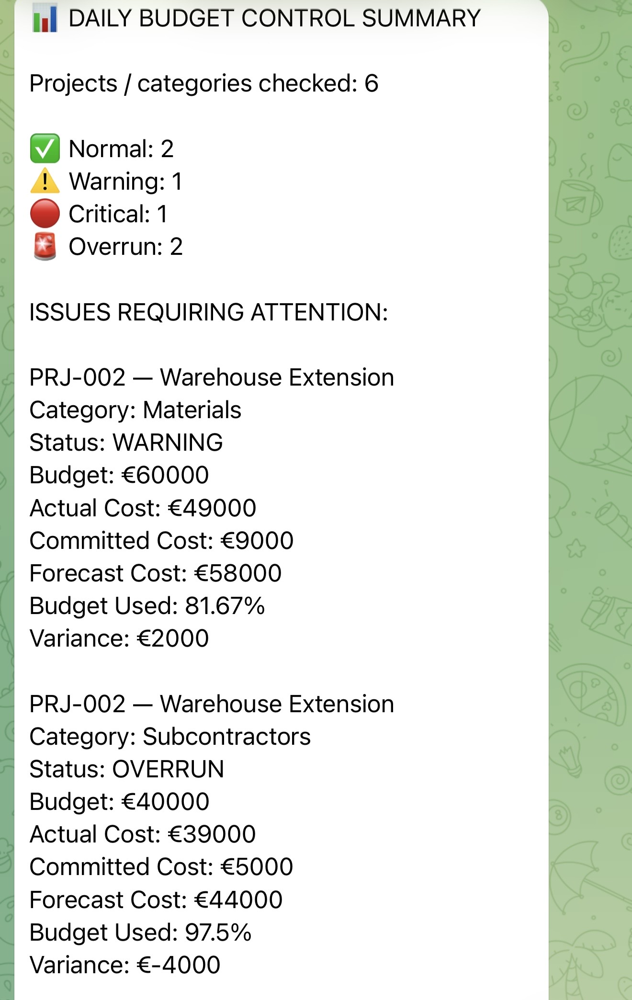
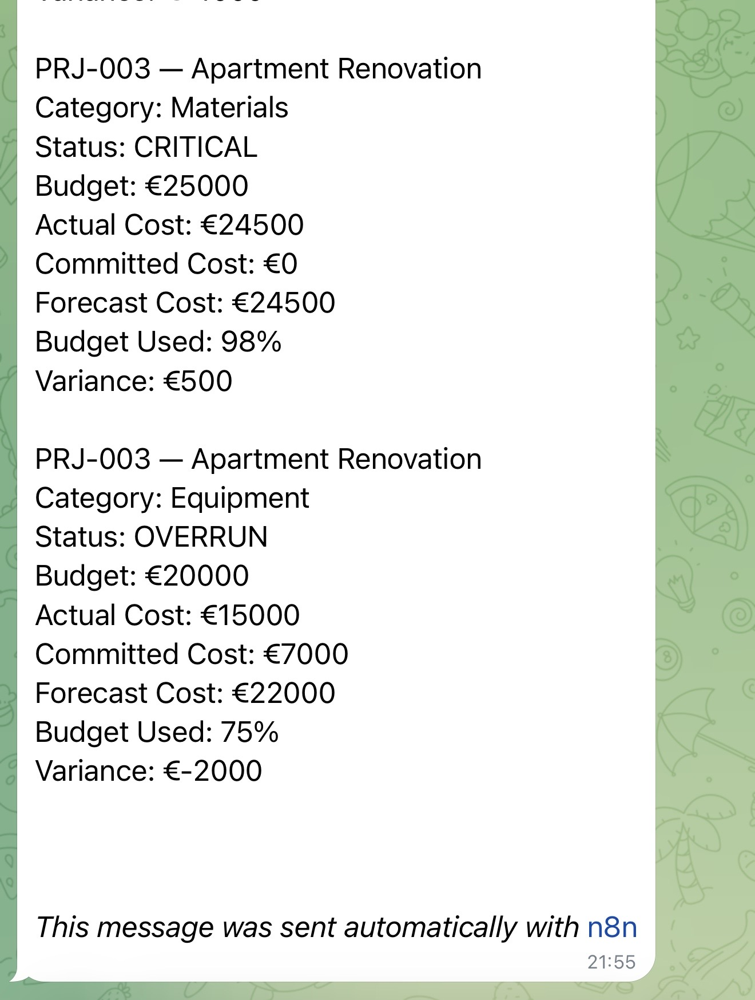

# Construction Cost & Budget Control System

Automated n8n workflow for construction project cost monitoring, budget variance analysis, risk classification, and management reporting.

## Overview

This project monitors construction budgets by combining planned project budgets with actual and committed cost transactions.

The workflow automatically:

- retrieves project budgets from Google Sheets
- retrieves actual and committed cost transactions
- aggregates costs by project and cost category
- calculates forecast cost, variance, and budget usage
- classifies each budget line as `NORMAL`, `WARNING`, `CRITICAL`, or `OVERRUN`
- updates the Budget Control sheet without creating duplicate records
- sends severity-based Telegram alerts
- generates a consolidated daily management summary

## Business Logic

The workflow uses the following rules:

- `NORMAL` — budget usage below 80%
- `WARNING` — budget usage from 80% to below 95%
- `CRITICAL` — budget usage at or above 95%
- `OVERRUN` — forecast cost exceeds the approved budget

Forecast cost is calculated from:

`Actual Cost + Committed Cost`

A unique `Budget Key` is generated from:

`Project ID + Cost Category`

This allows the workflow to update existing budget records safely instead of creating duplicates on repeated runs.

## Workflow Architecture

The system includes:

- scheduled budget control execution
- Google Sheets data retrieval
- two-source data synchronization
- JavaScript-based aggregation and calculations
- budget status classification
- append-or-update logic
- risk-based routing
- Telegram alerts
- management summary generation



## Input Data

### Project Budgets

Approved budgets are stored by project and cost category.



### Cost Transactions

Actual and committed costs are stored as individual transactions.



## Budget Calculation

The workflow combines budget and transaction data, then calculates:

- Actual Cost
- Committed Cost
- Forecast Cost
- Variance
- Budget Used %
- Budget Status



## Budget Control Output

The calculated results are written back to Google Sheets.

Repeated workflow runs update existing rows using the unique `Budget Key`, preventing duplicate records.



## Automated Risk Alerts

Only budget lines requiring attention are routed to Telegram.

The workflow sends separate alerts for:

- `WARNING`
- `CRITICAL`
- `OVERRUN`



## Daily Management Summary

The workflow also generates one consolidated management report containing:

- number of checked project/category combinations
- number of Normal, Warning, Critical, and Overrun items
- detailed information for all budget issues requiring attention





## Technologies

- n8n
- Google Sheets
- JavaScript
- Telegram Bot API

## Key Concepts Demonstrated

- construction cost control
- budget variance analysis
- committed cost tracking
- financial forecasting
- multi-source data processing
- aggregation by project and cost category
- conditional routing
- duplicate-safe updates
- management alerts
- automated reporting
- scheduled workflow execution

## Example Use Cases

This type of workflow can be adapted for:

- construction companies
- renovation companies
- project-based service businesses
- internal project cost monitoring
- department budget tracking
- contractor and subcontractor cost control

## Project Structure

```text
Construction Cost & Budget Control System
│
├── Retrieve Project Budgets
├── Retrieve Cost Transactions
├── Combine Budget & Cost Sources
├── Calculate Budget Metrics
├── Update Budget Control
├── Route Budget Risk
│   ├── Prepare Warning Alert
│   ├── Prepare Critical Alert
│   └── Prepare Overrun Alert
├── Send Telegram Alerts
├── Generate Management Summary
└── Send Management Summary
```

## Notes

The dataset used in this repository is sample project data created for workflow demonstration.

Credentials and sensitive connection details should not be included in the public workflow export.
